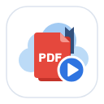

<p align="center">
  
</p>

<h1 align="center">Resume Reading for Google Drive™</h1>
<p align="center">PDF 이어보기 for Google Drive™</p>

<p align="center">
  Google Drive™ PDF 미리보기를 지난번에 보던 페이지에서 바로 열어 주는 Chrome 확장 프로그램
</p>

> **English** — Google Drive™ always opens PDF previews at page 1. This extension remembers the page you last stayed on for each PDF and jumps back to it the next time you open the preview. No sign-in, no Drive API, nothing sent to any server.

---

## 기능

- **자동 이어보기** — 미리보기를 열면 클릭 없이 마지막으로 머문 페이지로 이동합니다.
- **두 가지 미리보기 지원** — 파일 목록에서 여는 오버레이 미리보기와 새 탭 미리보기(`/file/d/{id}/view`) 모두 동작하며, 바둑판·목록 보기와 여러 Google 계정(`/u/1/`)에서도 동작합니다.
- **기기 간 동기화** — Chrome 동기화를 통해 다른 데스크톱 Chrome에서도 이어서 읽을 수 있습니다.
- **이동 알림** — "N페이지로 이동했어요" 토스트를 잠깐 보여 주며, 옵션에서 끌 수 있습니다.
- **영어·한국어** 지원

"마지막 페이지"는 가장 멀리 읽은 페이지가 아니라 **마지막으로 머문 페이지**입니다.

## 설치

- **Chrome 웹스토어**: 심사 중입니다 (게시 후 링크 추가 예정).
- **직접 설치(개발 버전)**: 아래 [개발](#개발) 참고.

## 개인정보

- 개발자에게 전송되거나 수집되는 데이터가 없습니다. 네트워크 요청을 보내지 않습니다.
- 저장하는 것은 PDF별 **Drive 파일 ID와 페이지 번호**(및 기록 시각), 알림 설정뿐입니다. 파일 이름·내용·계정 정보는 저장하지 않습니다.
- 저장 위치는 사용자 브라우저(`chrome.storage.local`)와 사용자 본인의 Chrome 동기화 저장소(`chrome.storage.sync`)입니다.
- 권한은 `storage`와 `drive.google.com` 접근만 사용합니다. Drive API·OAuth를 쓰지 않습니다.

자세한 내용은 [개인정보처리방침](https://dragonwaterr.github.io/resume_reading_preview_for_google_drive/privacy.html)을 참고하세요.

## 제한 사항

- Google Drive™ 웹 미리보기에서만 동작합니다. Chrome 내장 PDF 뷰어나 다운로드한 파일에는 적용되지 않습니다.
- 확장 프로그램이 업데이트된 직후에는 이미 열려 있던 Drive 탭을 새로고침해야 합니다.
- 같은 폴더에 이름이 같은 PDF가 여러 개 있으면 오버레이 미리보기에서는 기록하지 않습니다 (잘못된 파일에 기록하지 않기 위해).
- Drive 화면 구조가 바뀌면 동작이 멈출 수 있습니다. 이 경우 오류 없이 조용히 동작을 멈추며, 수정 버전으로 대응합니다.

## 동작 방식

1. 0.5초마다 화면에 보이는 PDF 뷰어와 파일 ID를 확인해 미리보기 진입·전환·닫힘을 감지합니다.
2. 진입하면 **조회 → (기록이 있으면) 이동 → 기록 시작** 순서로 처리합니다. 진입 직후의 1페이지가 저장된 기록을 덮어쓰지 않도록, 추적은 이동이 끝난 뒤 시작하고 사용자가 페이지를 바꿨을 때만 저장합니다.
3. 저장은 local과 sync 양쪽에 하고, 읽을 때는 기록 시각이 더 최신인 값을 씁니다. sync는 항목 수 한도가 있어 오래 열지 않은 기록부터 정리하며, local은 지우지 않습니다.

설계 결정과 근거는 [`docs/PLAN.md`](docs/PLAN.md)의 ADR 섹션에 정리되어 있습니다.

## 개발

빌드 도구 없이 순수 JavaScript로 작성했습니다.

**로드**
1. `chrome://extensions`에서 개발자 모드를 켭니다.
2. "압축해제된 확장 프로그램을 로드합니다"로 이 저장소 폴더를 선택합니다.
3. 코드를 수정하면 확장을 새로고침하고, content script를 고쳤다면 Drive 탭도 새로고침합니다.

`manifest.json`의 `key`는 개발 중 여러 기기에서 확장 ID를 같게 맞추기 위한 값입니다 (sync 테스트용). 배포 zip에서는 제거됩니다.

**테스트** (Node.js 필요, 의존성 없음)
```sh
node --test tests/
```

**배포 zip 만들기**
```sh
node scripts/build.js   # dist/resume-reading-<version>.zip
```
필요한 파일만 담고, 개발용 `key` 제거와 디버그 로그 끄기를 복사본에서만 적용합니다.

**아이콘 다시 만들기** (macOS, Chrome 설치 필요)
```sh
./scripts/render-icons.sh   # assets/*.svg → icons/*.png
```

## 구조

```
manifest.json
_locales/{en,ko}/messages.json   UI 문구
src/content/
  driveDom.js        Drive DOM에 의존하는 코드는 모두 여기에만 둠
  main.js            진입 감지, 조회 → 이동 → 기록 시작
  tracker.js         페이지 변경 시에만 debounce 저장
  bookmarkStore.js   local + sync 이중 저장, sync 한도 관리
  bookmarkLogic.js   최신값 선택·삭제 대상 선정 (순수 함수)
  toast.js           Shadow DOM 이동 알림
  log.js             개발용 로그
src/shared/settings.js           알림 설정 (sync)
src/options/                     옵션 페이지
tests/                           node:test 단위·통합 테스트
scripts/                         배포 zip, 아이콘 렌더링
spike/                           Drive 뷰어 구조 조사용 콘솔 스니펫 (배포 제외)
docs/                            기획·결정 기록, 스토어 등록 문구, 개인정보처리방침
```

---

Not affiliated with Google. Google Drive is a trademark of Google LLC.
